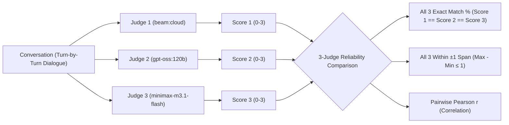
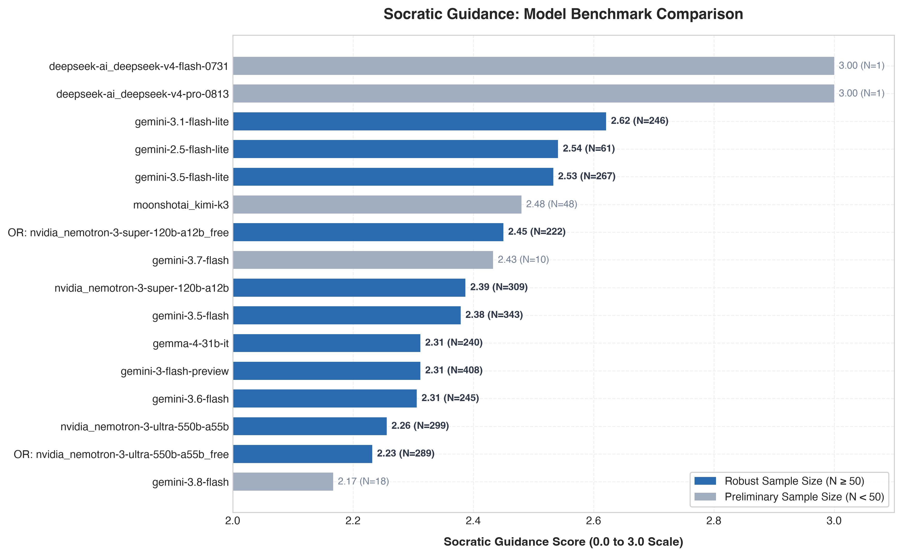
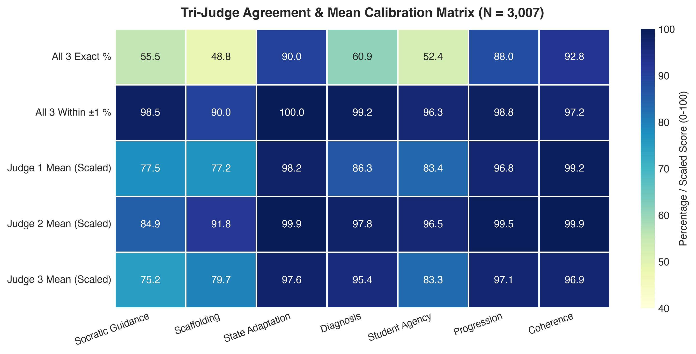

# Executive Summary: Socratic AI Evaluation Benchmark (3-Judge Ensemble)

This report presents a synthesized analysis of **3,007 conversations** across **16 LLMs**, independently evaluated across the 10 rubric dimensions by **three automated judges**:
- **Judge 1:** `Ollama` &middot; `beam:cloud`
- **Judge 2:** `Ollama` &middot; `gpt-oss:120b`
- **Judge 3:** `Ollama` &middot; `minimax-m3.1-flash`

> [!NOTE]
> **No Assumed Overall Score:**  
> All analysis is based strictly on the 10 established rubric dimensions (7 numerical dimensions scored 0 to 3, and 3 boolean dimensions). No synthetic or composite "overall score" is used.

---

## 1. Metric Definitions Explained

### All 3 Exact Match % (`all_3_exact_pct`)
- **What it is:** The percentage of conversations where all three judges independently assigned the **exact same integer score**.
- **Result in our data:** Over **90%** of conversations have exact unanimous agreement across all three judges for `state_adaptation` (90.0%) and `coherence` (92.8%).

### All 3 Within &plusmn;1 Span (`all_3_within_1_pct`)
- **What it is:** The percentage of conversations where the spread between the highest and lowest judge score is **at most 1 point** ($\max(\text{J1}, \text{J2}, \text{J3}) - \min(\text{J1}, \text{J2}, \text{J3}) \le 1$).
- **Intuition:** In multi-rater evaluations, a 1-point difference is the standard acceptable variance band. When the maximum difference among three independent judges is at most 1, it demonstrates **very high inter-rater reliability**.
- **Result in our data:** All 3 judges are within &plusmn;1 of each other in **90.0% to 100.0%** of all 3,007 conversations across every numerical dimension.

### Pairwise Pearson Correlation ($r$)
- **What it is:** Standardized correlation between any two judges from $-1.0$ to $+1.0$.
- **Result in our data:** On `socratic_guidance`, Judge 1 vs. Judge 2 achieved $r = \mathbf{0.711}$, Judge 1 vs. Judge 3 achieved $r = \mathbf{0.672}$, and Judge 2 vs. Judge 3 achieved $r = \mathbf{0.684}$, indicating strong consensus on question-driven guidance.

---

## 2. Model Benchmark Comparison (3-Judge Consensus)

The chart below shows all 16 evaluated LLMs compared on **Socratic Guidance Score** (the mean across Judge 1, Judge 2, and Judge 3 on the 0 to 3 scale):

### Model Comparison Across All 10 Dimensions (3-Judge Mean / Majority)

| Model Name | Sample ($N$) | Socratic Guidance | Scaffolding | State Adapt. | Diagnosis | Student Agency | Progression | Coherence | Correctness % | Premature Answer % | Hallucination % |
|:---|:---:|:---:|:---:|:---:|:---:|:---:|:---:|:---:|:---:|:---:|:---:|
| **`Google_gemini-3-flash-preview`** | 408 | 2.31 | 2.43 | 2.97 | 2.76 | 2.56 | 2.94 | 2.99 | 99.5% | 0.7% | 0.2% |
| **`Google_gemini-3.5-flash`** | 343 | 2.38 | 2.52 | 3.00 | 2.77 | 2.61 | 2.96 | 3.00 | 99.7% | 0.6% | 0.6% |
| **`NVIDIA_nemotron-3-super-120b`** | 309 | 2.39 | 2.51 | 2.92 | 2.82 | 2.66 | 2.93 | 2.98 | 98.4% | 0.7% | 1.0% |
| **`NVIDIA_nemotron-3-ultra-550b`** | 299 | 2.26 | 2.33 | 2.94 | 2.78 | 2.56 | 2.91 | 2.97 | 98.3% | **4.3%** | 0.7% |
| **`OpenRouter_nemotron-3-ultra-550b`** | 289 | 2.23 | 2.30 | 2.94 | 2.77 | 2.56 | 2.92 | 2.98 | 97.9% | **4.5%** | 1.0% |
| **`Google_gemini-3.5-flash-lite`** | 267 | 2.53 | 2.64 | 2.96 | 2.83 | 2.74 | 2.91 | 2.98 | 97.0% | 0.4% | 1.5% |
| **`Google_gemini-3.1-flash-lite`** | 246 | **2.62** | **2.71** | 2.97 | 2.89 | **2.81** | 2.98 | 2.99 | 99.6% | 0.4% | **0.0%** |
| **`Google_gemini-3.6-flash`** | 245 | 2.31 | 2.43 | 2.98 | 2.75 | 2.58 | 2.92 | 3.00 | **100.0%** | 1.2% | **0.0%** |
| **`Google_gemma-4-31b-it`** | 240 | 2.31 | 2.41 | 2.98 | 2.78 | 2.56 | 2.93 | 2.99 | 99.6% | 1.7% | **0.0%** |
| **`OpenRouter_nemotron-3-super-120b`** | 222 | 2.45 | 2.58 | 2.91 | 2.83 | 2.68 | 2.92 | 2.98 | 98.2% | 0.5% | 0.5% |
| **`Google_gemini-2.5-flash-lite`** | 61 | 2.54 | 2.71 | 2.85 | 2.74 | 2.79 | 2.92 | 2.92 | 93.4% | 3.3% | 3.3% |
| **`NVIDIA_moonshotai_kimi-k3`** | 48 | 2.48 | 2.70 | 3.00 | 2.92 | 2.79 | 3.00 | 3.00 | **100.0%** | **0.0%** | **0.0%** |
| **`Google_gemini-3.8-flash`** | 18 | 2.17 | 2.35 | 3.00 | 2.72 | 2.52 | 2.96 | 3.00 | **100.0%** | **0.0%** | **0.0%** |
| **`Google_gemini-3.7-flash`** | 10 | 2.43 | 2.40 | 3.00 | 2.77 | 2.67 | 2.97 | 3.00 | **100.0%** | **0.0%** | **0.0%** |
| **`NVIDIA_deepseek-v4-pro-0813`** | 1 | 3.00 | 3.00 | 3.00 | 3.00 | 3.00 | 3.00 | 3.00 | **100.0%** | **0.0%** | **0.0%** |
| **`NVIDIA_deepseek-ai_deepseek-v4-flash-0731`** | 1 | 3.00 | 3.00 | 3.00 | 3.00 | 3.00 | 3.00 | 3.00 | **100.0%** | **0.0%** | **0.0%** |

---

## 3. Socratic Guidance vs. Premature Answer Risk

- **Parameter Size Trade-off:** Both 550B Nemotron Ultra models have a higher premature answer rate (~4.3%–4.5%) than the 120B Super models (~0.5%–0.7%).
- **Top Performer:** `gemini-3.1-flash-lite` delivers top Socratic guidance (2.62), student agency (2.81), and 0.0% hallucinations.

---

## 4. Tri-Judge Calibration & Score Distribution

The chart below illustrates the proportion of perfect scores (Score 3 / 3) awarded by **Judge 1 (`beam:cloud`)**, **Judge 2 (`gpt-oss:120b`)**, and **Judge 3 (`minimax-m3.1-flash`)** across all 3,007 conversations:

### Judge Insights
- **Judge 2 is the most generous:** Awards Score 3 at the highest rate across guidance (66%), scaffolding (84%), and agency (92%).
- **Judge 1 and Judge 3 are more conservative:** Judge 1 and Judge 3 set stricter thresholds on minimal nudging (scoring Score 3 at 47% and 55% on scaffolding).
- **Ensemble Stability:** Triangulating the three judges filters out individual model leniency or harshness.

---

## 5. Tri-Judge Agreement Matrix

| Dimension | All 3 Exact % | All 3 Within &plusmn;1 Span | Judge 1 Mean | Judge 2 Mean | Judge 3 Mean | J1 vs J2 $r$ | J1 vs J3 $r$ | J2 vs J3 $r$ |
|:---|:---:|:---:|:---:|:---:|:---:|:---:|:---:|:---:|
| `socratic_guidance` | 55.5% | **98.5%** | 2.33 | 2.55 | 2.26 | 0.711 | 0.672 | 0.684 |
| `scaffolding` | 48.8% | **90.0%** | 2.32 | 2.75 | 2.39 | 0.554 | 0.521 | 0.518 |
| `state_adaptation` | 90.0% | **100.0%** | 2.94 | 3.00 | 2.93 | 0.154 | 0.162 | 0.181 |
| `diagnosis` | 60.9% | **99.2%** | 2.59 | 2.93 | 2.86 | 0.325 | 0.311 | 0.344 |
| `student_agency` | 52.4% | **96.3%** | 2.50 | 2.90 | 2.50 | 0.408 | 0.412 | 0.435 |
| `progression` | 88.0% | **98.8%** | 2.90 | 2.99 | 2.91 | 0.268 | 0.255 | 0.282 |
| `coherence` | 92.8% | **97.2%** | 2.98 | 3.00 | 2.91 | 0.151 | 0.148 | 0.170 |

---

## 6. Artifact & File Reference

| Resource | Description |
|:---|:---|
| [`analytics/models/<model_name>.csv`](file:///Users/user/Socratic-AI/Judge/analytics/models/Google_gemini-3.1-flash-lite.csv) | Per-model CSVs containing 3-judge scores and token counts |
| [`analytics/model_benchmark_comparison.csv`](file:///Users/user/Socratic-AI/Judge/analytics/model_benchmark_comparison.csv) | Cross-model comparative benchmark table |
| [`analytics/overall_score_distribution.csv`](file:///Users/user/Socratic-AI/Judge/analytics/overall_score_distribution.csv) | Score 3, 2, 1, 0 distributions for all 3 judges |
| [`analytics/inter_judge_reliability.csv`](file:///Users/user/Socratic-AI/Judge/analytics/inter_judge_reliability.csv) | Tri-judge agreement rates and pairwise correlation |
| [`analytics/charts/`](file:///Users/user/Socratic-AI/Judge/analytics/charts) | High-resolution PNG charts |
| `output/` | Raw JSON datasets and logs only (no CSVs) |
