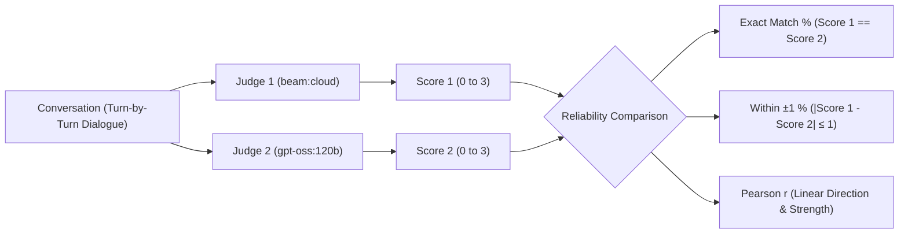
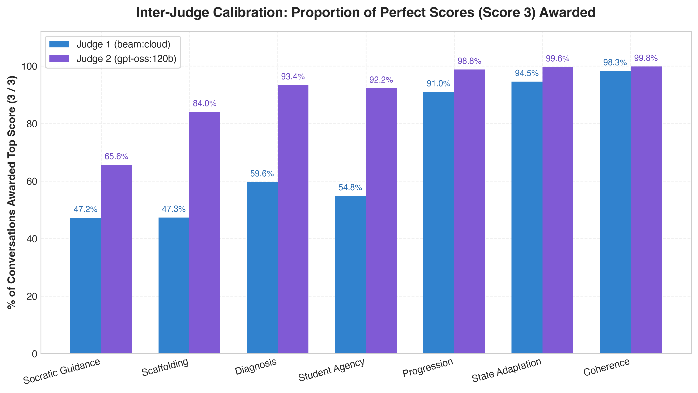

# Executive Summary: Socratic AI Evaluation Benchmark

This report presents a synthesized analysis of **3,007 conversations** across **16 LLMs**, independently evaluated across the 10 dimensions by two automated judges:
- **Judge 1:** `Ollama` &middot; `beam:cloud`
- **Judge 2:** `Ollama` &middot; `gpt-oss:120b`

> [!NOTE]
> **No Assumed Overall Score:**  
> All analysis is based strictly on the 10 established rubric dimensions (7 numerical dimensions scored 0 to 3, and 3 boolean dimensions). No synthetic or composite "overall score" is used.

---

## 1. Metric Definitions Explained

Before examining the results, here is what the core statistical metrics mean:

### Exact Match % (`exact_match_pct`)
- **What it is:** The percentage of conversations where both judges assigned the **exact same score**.
- **Intuition:** If Judge 1 gives a `3` and Judge 2 gives a `3`, it is an exact match. If Judge 1 gives `2` and Judge 2 gives `3`, it is not.
- **Example:** On **`state_adaptation`**, exact match is **94.7%** &mdash; both judges almost always select the exact same rating.

### Within &plusmn;1 % (`within_1_pct`)
- **What it is:** The percentage of conversations where the two judges differed by **at most 1 score point** ($|\text{Judge 1} - \text{Judge 2}| \le 1$).
- **Intuition:** In human and LLM rubric grading (e.g. 0 to 3 scale), human evaluators frequently disagree between adjacent buckets ("Adequate = 2" vs. "Strong = 3"). "Within &plusmn;1" represents the **industry standard tolerance window for inter-rater reliability**.
- **Result in our data:** Across all 7 numerical dimensions, the judges are within &plusmn;1 in **94.2% to 100.0%** of all 3,007 conversations. This confirms that severe disagreements (e.g., one judge scoring 0 and the other scoring 3) are virtually non-existent (<0.5%).

### Pearson Correlation Coefficient ($r$) (`pearson_r`)
- **What it is:** A standardized measure of linear correlation ranging from **$-1.0$** (perfect inverse relationship) to **$+1.0$** (perfect positive alignment).
- **Intuition:** It answers: *"When Judge 1 thinks a conversation is better than average, does Judge 2 also rank it higher?"*
  - $r > 0.70$: Strong alignment.
  - $0.40 \le r \le 0.70$: Moderate alignment.
  - $r < 0.30$: Weak correlation (often occurs when scores are clustered around the ceiling, e.g. Coherence where 98%+ of scores are 3).
- **Result in our data:** **`socratic_guidance`** has the strongest Pearson correlation ($r = 0.711$), demonstrating strong agreement between the two models on what constitutes genuine Socratic questioning.

---

## 2. Model Benchmark Comparison (by Socratic Guidance)

The chart below shows all 16 evaluated LLMs compared on **Socratic Guidance Score** (the mean of Judge 1 and Judge 2 on the 0 to 3 scale):

### Model Comparison Across All 10 Metrics

| Model Name | Sample ($N$) | Socratic Guidance | Scaffolding | State Adapt. | Diagnosis | Student Agency | Progression | Coherence | Correctness % | Premature Answer % | Hallucination % |
|:---|:---:|:---:|:---:|:---:|:---:|:---:|:---:|:---:|:---:|:---:|:---:|
| **`Google_gemini-3-flash-preview`** | 408 | 2.40 | 2.48 | 2.97 | 2.71 | 2.63 | 2.96 | 2.99 | 99.5% | 3.7% | 0.5% |
| **`Google_gemini-3.5-flash`** | 343 | 2.47 | 2.60 | 3.00 | 2.73 | 2.70 | 2.96 | 3.00 | 98.8% | 1.5% | 0.9% |
| **`NVIDIA_nemotron-3-super-120b`** | 309 | 2.45 | 2.56 | 2.94 | 2.79 | 2.74 | 2.94 | 2.98 | 98.1% | 1.9% | 1.3% |
| **`NVIDIA_nemotron-3-ultra-550b`** | 299 | 2.30 | 2.37 | 2.95 | 2.75 | 2.62 | 2.91 | 2.97 | 96.7% | **9.0%** | 1.7% |
| **`OpenRouter_nemotron-3-ultra-550b`** | 289 | 2.27 | 2.36 | 2.96 | 2.74 | 2.62 | 2.93 | 2.99 | 97.9% | **8.7%** | 1.0% |
| **`Google_gemini-3.5-flash-lite`** | 267 | 2.56 | 2.65 | 2.98 | 2.82 | 2.79 | 2.93 | 2.98 | 96.6% | 2.2% | 1.5% |
| **`Google_gemini-3.1-flash-lite`** | 246 | **2.67** | **2.72** | 2.99 | 2.86 | **2.84** | 2.99 | 2.99 | 98.8% | 2.4% | **0.0%** |
| **`Google_gemini-3.6-flash`** | 245 | 2.38 | 2.49 | 2.99 | 2.72 | 2.66 | 2.94 | 3.00 | **100.0%** | 3.3% | **0.0%** |
| **`Google_gemma-4-31b-it`** | 240 | 2.37 | 2.46 | 2.98 | 2.72 | 2.63 | 2.93 | 2.99 | 99.6% | 3.8% | **0.0%** |
| **`OpenRouter_nemotron-3-super-120b`** | 222 | 2.52 | 2.62 | 2.93 | 2.79 | 2.76 | 2.94 | 2.98 | 98.2% | 1.8% | 0.9% |
| **`Google_gemini-2.5-flash-lite`** | 61 | 2.59 | 2.74 | 2.92 | 2.79 | 2.82 | 2.96 | 2.94 | 91.8% | 4.9% | 4.9% |
| **`NVIDIA_moonshotai_kimi-k3`** | 48 | 2.52 | 2.75 | 3.00 | 2.88 | 2.83 | 3.00 | 3.00 | **100.0%** | **0.0%** | **0.0%** |
| **`Google_gemini-3.8-flash`** | 18 | 2.17 | 2.28 | 3.00 | 2.67 | 2.61 | 2.97 | 3.00 | **100.0%** | 5.6% | **0.0%** |
| **`Google_gemini-3.7-flash`** | 10 | 2.50 | 2.50 | 3.00 | 2.75 | 2.75 | 3.00 | 3.00 | **100.0%** | **0.0%** | **0.0%** |
| **`NVIDIA_deepseek-v4-pro-0813`** | 1 | 3.00 | 3.00 | 3.00 | 3.00 | 3.00 | 3.00 | 3.00 | **100.0%** | **0.0%** | **0.0%** |
| **`NVIDIA_deepseek-v4-flash-0731`** | 1 | 3.00 | 3.00 | 3.00 | 3.00 | 3.00 | 3.00 | 3.00 | **100.0%** | **0.0%** | **0.0%** |

---

## 3. Socratic Guidance vs. Premature Answer Risk

A critical failure mode in tutoring is **prematurely providing the final answer** rather than allowing the student to reason through it.

- **Parameter Size Trade-off:** **`nemotron-3-ultra-550b`** (550B parameters) exhibits a **9.0% premature answer rate**, four times higher than the smaller **`nemotron-3-super-120b`** (**1.9%**). Ultra-550B models frequently jump directly to explaining the full solution rather than scaffolded questioning.
- **Top Guidance:** **`gemini-3.1-flash-lite`** maintains high Socratic guidance (2.67) and agency (2.84) with low premature answering (2.4%) and 0% hallucinations.

---

## 4. Judge Calibration & Score Distribution

The chart below compares the proportion of top scores (Score 3 / 3) awarded by **Judge 1 (`beam:cloud`)** versus **Judge 2 (`gpt-oss:120b`)** across all 3,007 conversations:

### Summary of Judge Behavior
- **Judge 2 is more generous:** On dimensions like `scaffolding` (84.0% vs. 47.3%) and `student_agency` (92.2% vs. 54.8%), Judge 2 awards Score 3 more freely.
- **Judge 1 is more discerning:** Judge 1 enforces stricter criteria on what qualifies as a "minimal nudge" in scaffolding.
- **Taking the mean $(\text{Judge 1} + \text{Judge 2})/2$ balances both judges:** It prevents single-judge bias and produces balanced scores.

---

## 5. Inter-Judge Agreement Matrix

| Dimension | Exact Match % | Within &plusmn;1 % | Mean Absolute Error (MAE) | Pearson $r$ | Judge 1 Mean | Judge 2 Mean |
|:---|:---:|:---:|:---:|:---:|:---:|:---:|
| `socratic_guidance` | 69.7% | **98.8%** | 0.315 | **0.711** | 2.33 | 2.55 |
| `scaffolding` | 56.0% | **94.2%** | 0.502 | **0.554** | 2.32 | 2.75 |
| `state_adaptation` | 94.7% | **100.0%** | 0.054 | 0.154 | 2.95 | 3.00 |
| `diagnosis` | 65.5% | **99.6%** | 0.350 | 0.325 | 2.59 | 2.93 |
| `student_agency` | 59.9% | **97.9%** | 0.422 | 0.408 | 2.50 | 2.90 |
| `progression` | 91.4% | **99.5%** | 0.091 | 0.268 | 2.90 | 2.99 |
| `coherence` | 98.2% | **99.3%** | 0.025 | 0.151 | 2.98 | 3.00 |

---

## 6. Artifact & File Reference

| Resource | Description |
|:---|:---|
| [`analytics/model_benchmark_comparison.csv`](file:///Users/user/Socratic-AI/Judge/analytics/model_benchmark_comparison.csv) | Full metrics table across all 16 models |
| [`analytics/overall_score_distribution.csv`](file:///Users/user/Socratic-AI/Judge/analytics/overall_score_distribution.csv) | Breakdown of Score 3, 2, 1, 0 per judge |
| [`analytics/inter_judge_reliability.csv`](file:///Users/user/Socratic-AI/Judge/analytics/inter_judge_reliability.csv) | Exact match %, within-1 %, MAE, Pearson $r$ |
| [`analytics/charts/`](file:///Users/user/Socratic-AI/Judge/analytics/charts) | Directory containing high-resolution PNG charts |
| [`analytics/models/<model_name>.csv`](file:///Users/user/Socratic-AI/Judge/analytics/models/Google_gemini-3.1-flash-lite.csv) | Individual per-model CSVs with conversation-level evaluations |
