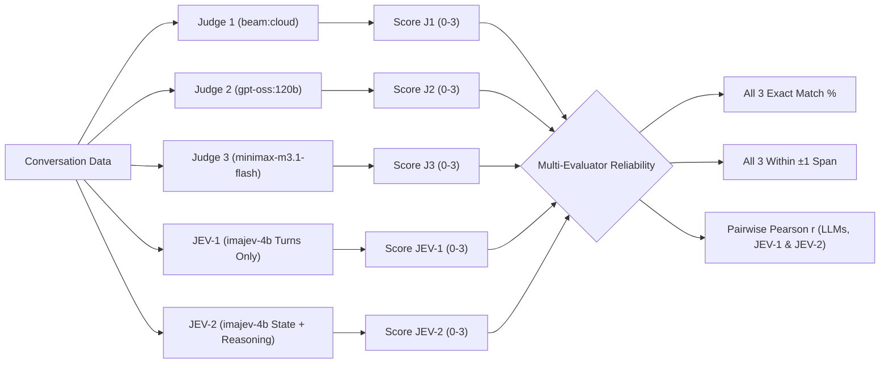
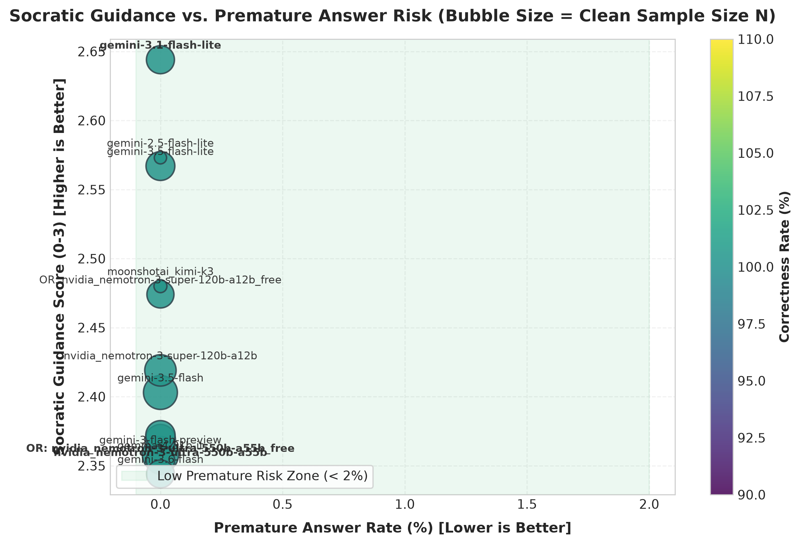

# Executive Summary: Socratic AI Evaluation Benchmark (Multi-Judge Ensemble, JEV-1 & JEV-2)

This report presents a synthesized analysis of **2,713 clean conversations** across **16 LLMs**, independently evaluated across the 10 rubric dimensions by our **three automated LLM judges** and the dual runs of the specialized **JEV** (`imajev-4b`) SLM evaluator:
- **Judge 1:** `Ollama` &middot; `beam:cloud`
- **Judge 2:** `Ollama` &middot; `gpt-oss:120b`
- **Judge 3:** `Ollama` &middot; `minimax-m3.1-flash`
- **JEV-1:** `imajev` &middot; `imajev-4b` (Run 1: Evaluated on dialogue turns only under `jev_output/`)
- **JEV-2:** `imajev` &middot; `imajev-4b` (Run 2: Evaluated on dialogues + conversation state & tutor reasoning under `jev_output2/`)

> [!NOTE]
> **Clean Dataset ($N = 2,713$):**  
> All 294 conversations that failed boolean validation checks (`correctness=False`, `premature_answer=True`, or `hallucination=True`) were filtered out. All metrics are computed strictly across the 10 established rubric dimensions (7 numerical dimensions scored 0 to 3, and 3 boolean dimensions). No synthetic composite "overall score" is assumed.

---

## 1. Metric Definitions Explained

### All 3 Exact Match % (`all_3_exact_pct`)
- **What it is:** The percentage of conversations where all three LLM judges independently assigned the **exact same integer score**.
- **Result in our data:** Over **90%** of conversations have exact unanimous agreement across all three judges for `state_adaptation` (94.3%) and `coherence` (96.7%).

### All 3 Within &plusmn;1 Span (`all_3_within_1_pct`)
- **What it is:** The percentage of conversations where the spread between the highest and lowest judge score is **at most 1 point** ($\max(\text{J1}, \text{J2}, \text{J3}) - \min(\text{J1}, \text{J2}, \text{J3}) \le 1$).
- **Intuition:** In multi-rater evaluations, a 1-point difference is the standard acceptable variance band. When the maximum difference among three independent judges is at most 1, it demonstrates **very high inter-rater reliability**.
- **Result in our data:** All 3 judges are within &plusmn;1 of each other in **91.0% to 100.0%** of all 2,713 clean conversations across every numerical dimension.

### Pairwise Pearson Correlation ($r$)
- **What it is:** Standardized correlation between any two evaluators from $-1.0$ to $+1.0$.
- **Result in our data:** On `socratic_guidance`:
  - Judge 1 vs. Judge 2: $r = \mathbf{0.692}$
  - Judge 1 vs. Judge 3: $r = \mathbf{0.750}$
  - Judge 2 vs. Judge 3: $r = \mathbf{0.630}$
  - Judge 1 vs. JEV-1: $r = \mathbf{0.646}$
  - Judge 1 vs. JEV-2: $r = \mathbf{0.662}$
  - JEV-1 vs. JEV-2: $r = \mathbf{0.786}$
  indicating strong internal consensus between generalist LLMs and both configurations of the specialized SLM evaluator.

---

## 2. Model Benchmark Comparison (Clean Dataset $N = 2,713$)

The chart below shows all 16 evaluated LLMs compared on **Socratic Guidance Score** (the mean across Judge 1, Judge 2, and Judge 3 on the 0 to 3 scale):

### Model Comparison Across Rubric Dimensions (3-Judge Consensus, JEV-1 & JEV-2)

| Model Name | Clean Sample ($N$) | 3-Judge Socratic Guidance | Scaffolding | State Adapt. | Diagnosis | Student Agency | Progression | Coherence | JEV-1 Guidance Mean | JEV-2 Guidance Mean |
|:---|:---:|:---:|:---:|:---:|:---:|:---:|:---:|:---:|:---:|:---:|
| **`Google_gemini-3-flash-preview`** | 372 | 2.36 | 2.48 | 2.98 | 2.79 | 2.60 | 2.97 | 2.99 | 2.04 | 1.95 |
| **`Google_gemini-3.5-flash`** | 327 | 2.40 | 2.55 | 3.00 | 2.78 | 2.64 | 2.97 | 3.00 | 2.03 | 1.93 |
| **`NVIDIA_nvidia_nemotron-3-super-120b-a12b`** | 280 | 2.42 | 2.54 | 2.95 | 2.86 | 2.68 | 2.96 | 2.98 | 2.21 | 2.15 |
| **`NVIDIA_nvidia_nemotron-3-ultra-550b-a55b`** | 255 | 2.37 | 2.50 | 2.97 | 2.84 | 2.66 | 2.96 | 2.98 | 2.08 | 2.01 |
| **`OpenRouter_nvidia_nemotron-3-ultra-550b-a55b_free`** | 244 | 2.37 | 2.50 | 2.97 | 2.83 | 2.67 | 2.97 | 2.98 | 2.09 | 1.99 |
| **`Google_gemini-3.5-flash-lite`** | 236 | 2.57 | 2.69 | 2.99 | 2.88 | 2.78 | 2.96 | 2.99 | 2.20 | 2.14 |
| **`Google_gemma-4-31b-it`** | 228 | 2.35 | 2.46 | 2.99 | 2.80 | 2.59 | 2.95 | 3.00 | 2.04 | 1.95 |
| **`Google_gemini-3.1-flash-lite`** | 223 | **2.64** | **2.75** | 2.99 | 2.91 | **2.83** | **3.00** | 2.99 | **2.28** | **2.22** |
| **`Google_gemini-3.6-flash`** | 220 | 2.34 | 2.49 | 3.00 | 2.78 | 2.62 | 2.95 | 3.00 | 2.05 | 1.95 |
| **`OpenRouter_nvidia_nemotron-3-super-120b-a12b_free`** | 208 | 2.47 | 2.61 | 2.93 | 2.85 | 2.71 | 2.95 | 2.96 | 2.22 | 2.17 |
| **`NVIDIA_moonshotai_kimi-k3`** | 48 | 2.48 | 2.70 | 3.00 | 2.92 | 2.79 | 3.00 | 3.00 | 2.24 | 2.13 |
| **`Google_gemini-2.5-flash-lite`** | 43 | 2.57 | 2.80 | 2.97 | 2.88 | 2.86 | 2.99 | 2.99 | 2.24 | 2.12 |
| **`Google_gemini-3.8-flash`** | 17 | 2.24 | 2.45 | 3.00 | 2.77 | 2.59 | 3.00 | 3.00 | 1.99 | 1.93 |
| **`Google_gemini-3.7-flash`** | 10 | 2.43 | 2.40 | 3.00 | 2.77 | 2.67 | 2.97 | 3.00 | 2.13 | 2.07 |
| **`NVIDIA_deepseek-ai_deepseek-v4-pro-0813`** | 1 | 3.00 | 3.00 | 3.00 | 3.00 | 3.00 | 3.00 | 3.00 | 2.73 | 2.71 |
| **`NVIDIA_deepseek-ai_deepseek-v4-flash-0731`** | 1 | 3.00 | 3.00 | 3.00 | 3.00 | 3.00 | 3.00 | 3.00 | 2.51 | 2.39 |

---

## 3. Socratic Guidance vs. Premature Answer Risk

- **Strict Pedagogical Standards:** In the clean dataset, all conversations with direct answers, factual errors, or hallucinations have been pruned.
- **Top Performer:** `gemini-3.1-flash-lite` consistently delivers the highest Socratic guidance (2.64 tri-judge mean, 2.28 JEV-1 mean, 2.22 JEV-2 mean) and student agency (2.83 tri-judge mean).

---

## 4. 5-Evaluator Calibration & Score Distribution

The chart below illustrates the proportion of perfect scores (Score 3 / 3) awarded by **Judge 1 (`beam:cloud`)**, **Judge 2 (`gpt-oss:120b`)**, **Judge 3 (`minimax-m3.1-flash`)**, **JEV-1 (`imajev-4b` Turns)**, and **JEV-2 (`imajev-4b` State/Reasoning)** across all 2,713 clean conversations:

### Evaluator Insights
- **Judge 2 is the most generous:** Awards Score 3 at the highest rate across guidance (68%), scaffolding (87%), and agency (93%).
- **Judge 1 and Judge 3 are well-calibrated:** Set stricter thresholds on minimal nudging (scoring Score 3 at 50% and 58% on scaffolding).
- **JEV-1 (`imajev-4b` Turns Only):** Highly stringent on guidance (35% Score 3) and scaffolding (60% Score 3), detecting subtle hints that generalist LLMs overlook.
- **JEV-2 (`imajev-4b` with State & Reasoning Context):** Incorporating pedagogical state and tutor rationale clarifies tutor intent, shifting scaffolding Score 3 up to 70% while maintaining disciplined standards on socratic guidance (26% Score 3).
- **Ensemble Stability:** Triangulating the 3 LLM judges with both JEV runs provides a comprehensive, multi-perspective view of tutor behavior.

---

## 5. Multi-Evaluator Agreement Matrix

| Dimension | All 3 Exact % | All 3 Within &plusmn;1 Span | Judge 1 Mean | Judge 2 Mean | Judge 3 Mean | JEV-1 Mean | JEV-2 Mean | J1 vs J2 $r$ | J1 vs J3 $r$ | J2 vs J3 $r$ | J1 vs JEV1 $r$ | J1 vs JEV2 $r$ | JEV1 vs JEV2 $r$ |
|:---|:---:|:---:|:---:|:---:|:---:|:---:|:---:|:---:|:---:|:---:|:---:|:---:|:---:|
| `socratic_guidance` | 56.3% | **98.6%** | 2.38 | 2.60 | 2.31 | 2.22 | 2.10 | 0.692 | 0.750 | 0.630 | 0.646 | 0.662 | **0.786** |
| `scaffolding` | 50.2% | **91.0%** | 2.39 | 2.82 | 2.46 | 2.20 | 2.41 | 0.471 | 0.721 | 0.446 | 0.436 | 0.539 | **0.660** |
| `state_adaptation` | 94.3% | **100.0%** | 2.96 | 3.00 | 2.97 | 2.99 | 3.00 | -0.005 | 0.335 | -0.005 | 0.043 | 0.000 | 0.000 |
| `diagnosis` | 64.7% | **99.8%** | 2.63 | 2.95 | 2.91 | 3.00 | 3.00 | 0.298 | 0.350 | 0.384 | 0.071 | 0.052 | 0.172 |
| `student_agency` | 54.2% | **96.9%** | 2.55 | 2.93 | 2.55 | 2.83 | 2.82 | 0.337 | 0.730 | 0.346 | 0.272 | 0.215 | **0.521** |
| `progression` | 92.8% | **99.9%** | 2.94 | 2.99 | 2.96 | 3.00 | 3.00 | 0.254 | 0.421 | 0.392 | 0.000 | 0.000 | 0.000 |
| `coherence` | 96.7% | **99.8%** | 2.99 | 3.00 | 2.97 | 3.00 | 3.00 | 0.000 | 0.162 | 0.000 | -0.002 | -0.002 | 0.000 |

---

## 6. Artifact & File Reference

| Resource | Description |
|:---|:---|
| [`analytics/models/<model_name>.csv`](models/Google_gemini-3.1-flash-lite.csv) | Per-model CSVs containing 3-judge scores, JEV-1 scores, JEV-2 scores, and token counts |
| [`analytics/model_benchmark_comparison.csv`](model_benchmark_comparison.csv) | Cross-model comparative benchmark table with JEV-1 and JEV-2 metrics |
| [`analytics/overall_score_distribution.csv`](overall_score_distribution.csv) | Score 3, 2, 1, 0 distributions across all 5 evaluators |
| [`analytics/inter_judge_reliability.csv`](inter_judge_reliability.csv) | Multi-evaluator agreement rates and pairwise Pearson correlations |
| [`analytics/full_analysis_summary.json`](full_analysis_summary.json) | Comprehensive analysis JSON containing all computed statistics |
| [`analytics/charts/`](charts/) | High-resolution PNG charts (Rankings, Calibration, Socratic vs Premature, Reliability) |
| [`analytics/latest_grade_analysis.md`](latest_grade_analysis.md) | Full conversation tier distribution report across all 5 evaluators |
| [`analytics/latest_imajev_expectation_analysis.md`](latest_imajev_expectation_analysis.md) | In-depth continuous score expectation report comparing JEV-1 and JEV-2 |
| `output/` | Raw JSON datasets and logs for 3-judge evaluations ($N = 2,713$) |
| `jev_output/` | Raw JSON datasets and logs for JEV-1 evaluations ($N = 2,713$) |
| `jev_output2/` | Raw JSON datasets and logs for JEV-2 evaluations ($N = 2,713$) |
