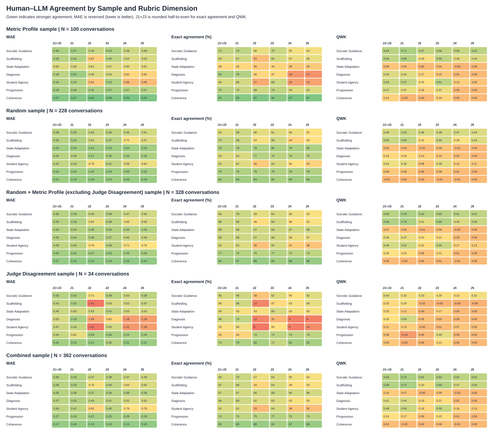
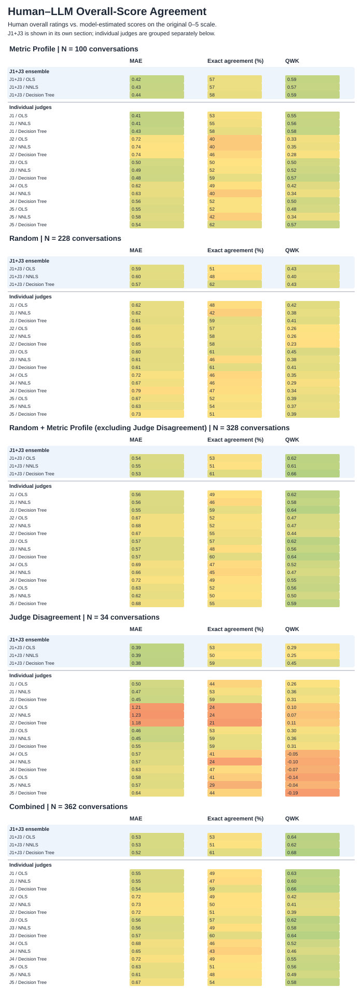

# Human–LLM Agreement Report

Human ratings are compared with the J1+J3 ensemble and Judges 1–5. The report shows each sample separately, Random + Metric Profile pooled, and all samples combined.

## Formulas

- **MAE:** `mean(|LLM score − human score|)` on the original score scale; lower is better.
- **Exact agreement:** `matching whole-score categories ÷ number of ratings × 100%`; higher is better.
- **QWK:** `1 − Σ(wᵢⱼOᵢⱼ) / Σ(wᵢⱼEᵢⱼ)`, where `wᵢⱼ = ((i − j)/K)²` and `K` is the scale maximum (3 for rubric ratings; 5 for overall scores). QWK is chance-adjusted; 1 is perfect agreement.
- Exact agreement and QWK use scores rounded to the nearest whole number (half ties to the nearest even integer). MAE uses unrounded scores.

## Rubric-score agreement

Tables show the macro-average across the seven rubric dimensions; each dimension has equal weight. Scores are on the original 0–3 scale.

### Metric Profile (N = 100 conversations)

| Evaluator | MAE (lower is better) | Exact agreement (higher is better) | QWK (higher is better) |
|---|---:|---:|---:|
| J1 + J3 ensemble | 0.327 | 70.3% | 0.411 |
| Judge 1 | 0.300 | 70.6% | 0.391 |
| Judge 2 | 0.534 | 52.7% | 0.207 |
| Judge 3 | 0.360 | 65.6% | 0.351 |
| Judge 4 | 0.550 | 50.4% | 0.151 |
| Judge 5 | 0.547 | 50.4% | 0.160 |

### Random (N = 228 conversations)

| Evaluator | MAE (lower is better) | Exact agreement (higher is better) | QWK (higher is better) |
|---|---:|---:|---:|
| J1 + J3 ensemble | 0.312 | 70.6% | 0.238 |
| Judge 1 | 0.311 | 72.1% | 0.255 |
| Judge 2 | 0.372 | 67.5% | 0.129 |
| Judge 3 | 0.313 | 72.1% | 0.229 |
| Judge 4 | 0.391 | 66.6% | 0.133 |
| Judge 5 | 0.385 | 65.9% | 0.141 |

### Random + Metric Profile (excluding Judge Disagreement) (N = 328 conversations)

| Evaluator | MAE (lower is better) | Exact agreement (higher is better) | QWK (higher is better) |
|---|---:|---:|---:|
| J1 + J3 ensemble | 0.316 | 70.5% | 0.356 |
| Judge 1 | 0.307 | 71.6% | 0.365 |
| Judge 2 | 0.422 | 63.0% | 0.222 |
| Judge 3 | 0.327 | 70.1% | 0.331 |
| Judge 4 | 0.439 | 61.7% | 0.176 |
| Judge 5 | 0.435 | 61.2% | 0.183 |

### Judge Disagreement (N = 34 conversations)

| Evaluator | MAE (lower is better) | Exact agreement (higher is better) | QWK (higher is better) |
|---|---:|---:|---:|
| J1 + J3 ensemble | 0.416 | 59.7% | 0.188 |
| Judge 1 | 0.391 | 63.0% | 0.161 |
| Judge 2 | 0.807 | 39.5% | 0.051 |
| Judge 3 | 0.466 | 57.1% | 0.154 |
| Judge 4 | 0.634 | 47.1% | 0.032 |
| Judge 5 | 0.605 | 50.4% | 0.046 |

### Combined (N = 362 conversations)

| Evaluator | MAE (lower is better) | Exact agreement (higher is better) | QWK (higher is better) |
|---|---:|---:|---:|
| J1 + J3 ensemble | 0.326 | 69.5% | 0.369 |
| Judge 1 | 0.315 | 70.8% | 0.376 |
| Judge 2 | 0.458 | 60.8% | 0.195 |
| Judge 3 | 0.340 | 68.9% | 0.349 |
| Judge 4 | 0.458 | 60.3% | 0.178 |
| Judge 5 | 0.451 | 60.2% | 0.186 |

### Rubric dashboard

## Overall-score agreement

Overall estimates are calculated by applying the existing OLS, NNLS, and Decision Tree models to the J1+J3 average or to each individual judge's seven rubric scores. The models and metric weights were fitted using human overall annotations, with J1+J3 rubric scores as training features. Scores are on the original 0–5 scale; exact agreement and QWK use rounded whole scores. The dashboard keeps J1+J3 separate from the individual judges for clarity.

## Critic / Key Findings

- On the combined rubric sample, J1 is stronger than J1+J3 on all three measures: MAE 0.315 vs. 0.326; exact agreement 70.8% vs. 69.5%; QWK 0.376 vs. 0.369. The ensemble is not shown to outperform J1 on these data.
- J1 and J3 are the strongest individual judges overall; J2, J4, and J5 have weaker combined results (MAE 0.458, 0.458, and 0.451).
- On the combined overall-score comparison, the strongest configuration is J1+J3 | Decision Tree for MAE, J1+J3 | Decision Tree for exact agreement, and J1+J3 | Decision Tree for QWK.
- Individual-judge overall scores are model estimates, not holistic scores assigned by those judges. The weights were trained using J1+J3 features and human overall annotations, then applied to each judge's scores; this is a cross-evaluator application of the same scoring rule.
- The scoring models were fitted using these same 362 human-rated conversations, so the overall comparisons are in-sample, not independent validation. There is only one human rating set per conversation; Random is the most representative sample, while the other samples are selected.
