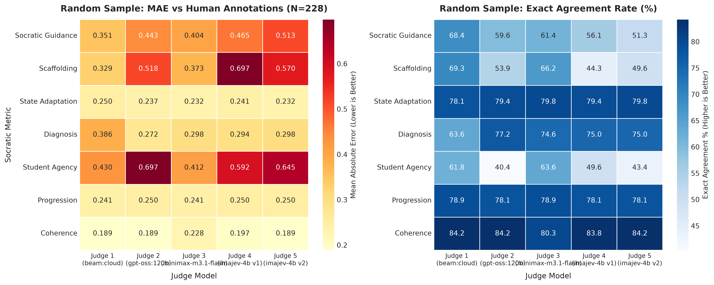
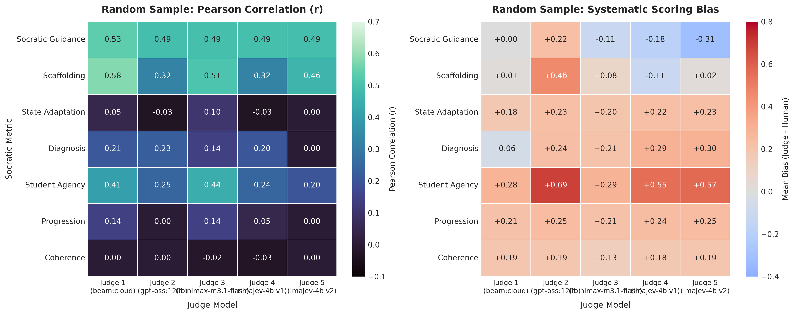
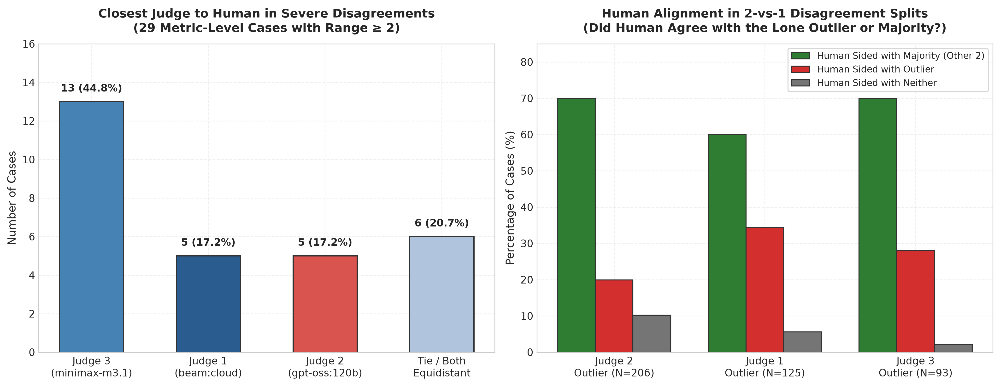
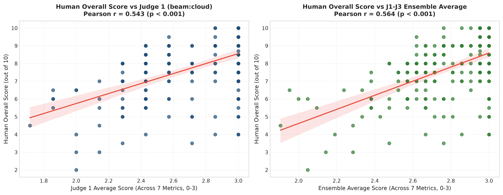

# Comprehensive Human Evaluation vs. 5 LLM Judges
## Analysis of the Random Benchmark Sample (228 Conversations)

**Dataset Scope**: Random Sample (`RND-0001` through `RND-0240`)  
**Completed Human Annotations**: 228 records (12 excluded leakage rows ignored; 100% ID-matched)  
**Total Paired Judgments**: 1,596 metric evaluations per judge ($228 \text{ conversations} \times 7 \text{ pedagogical metrics}$)  
**Judges Evaluated**:
- **Judge 1**: `beam:cloud` (Ollama)
- **Judge 2**: `gpt-oss:120b` (Ollama)
- **Judge 3**: `minimax-m3.1-flash` (Ollama)
- **Judge 4**: `imajev-4b` (v1, specialized Socratic evaluator)
- **Judge 5**: `imajev-4b v2` (v2, specialized Socratic evaluator)

---

## Executive Summary & Key Findings

> [!IMPORTANT]
> **Who is the most accurate judge on the natural Random Sample?**  
> Across all 1,596 paired judgments, **Judge 1 (`beam:cloud`) is once again the #1 overall judge**, closely followed by **Judge 3 (`minimax-m3.1-flash`)**:
> - **Lowest Error**: Judge 1 achieves **0.311 MAE** and **0.611 RMSE** (Judge 3 is essentially tied at **0.313 MAE**, **0.618 RMSE**).
> - **Highest Exact Agreement**: Judge 3 achieves **72.1%** and Judge 1 achieves **72.1%** exact match; both exceed **96.7%** within-1 point agreement.
> - **Highest Inter-Rater Reliability (QWK)**: Judge 1 reaches **0.439**, Judge 3 reaches **0.420** (both substantially outperforming Judge 2 at **0.229**).
> - **Lowest Systematic Bias**: Judge 1 has the lowest bias (**+0.117**), compared to **+0.325** for Judge 2.
> - **Decisive Performance on Core Metrics**: Judge 1 leads on *Socratic Guidance* ($r=0.534$, $\text{QWK}=0.534$) and *Scaffolding* ($r=0.579$, $\text{QWK}=0.577$), while Judge 3 leads on *Student Agency* ($r=0.442$, $\text{QWK}=0.391$).
>
> **Judge 2 (`gpt-oss:120b`)** is the **least reliable (#5)**: lowest QWK (**0.229**), lowest correlation ($r=0.319$), highest bias (**+0.325**), and lowest exact agreement (**67.5%**).

---

## 1. Overall Judge Benchmark Comparison (1,596 Pairs per Judge)

Pooling all 1,596 evaluations per judge against human gold-standard annotations:

| Metric | Judge 1 (`beam:cloud`) | Judge 2 (`gpt-oss:120b`) | Judge 3 (`minimax-m3.1`) | Judge 4 (`imajev-4b v1`) | Judge 5 (`imajev-4b v2`) | J1–J3 Ensemble Mean |
| :--- | :---: | :---: | :---: | :---: | :---: | :---: |
| **Overall Rank** | **#1** | #5 | **#2** | #4 | **#3** | **Ensemble Leader** |
| **Mean Absolute Error (MAE)** | **0.311** | 0.372 | **0.313** | 0.391 | 0.385 | **0.325** |
| **Root Mean Squared Error (RMSE)**| **0.611** | 0.684 | **0.618** | 0.712 | 0.689 | **0.580** |
| **Exact Agreement Rate (%)** | **72.1%** | 67.5% | **72.1%** | 66.6% | 65.9% | *Continuous* |
| **Within-1 Point Agreement (%)** | **96.9%** | 95.2% | **96.7%** | 94.4% | 95.6% | *Continuous* |
| **Systematic Bias ($\mu_J - \mu_H$)**| **+0.117** | +0.325 | +0.145 | +0.170 | +0.177 | +0.195 |
| **Pearson Correlation ($r$)** | **0.453** | 0.319 | **0.441** | 0.333 | 0.361 | **0.482** |
| **Spearman Rank ($\rho$)** | **0.448** | 0.297 | **0.432** | 0.330 | 0.327 | **0.452** |
| **Quadratic Weighted Kappa (QWK)**| **0.439** | 0.229 | **0.420** | 0.320 | 0.344 | **0.446 (median)** |

> [!TIP]
> **Ensemble Performance**: The J1–J3 Ensemble Median delivers the best overall balance on discrete ratings (**Exact Agreement = 74.6%**, **Within-1 = 96.7%**, **QWK = 0.446**, **MAE = 0.286**).

---

## 2. Metric-by-Metric Breakdown & Correlation Analysis

### Socratic Guidance (0–3 Scale)
- **Human Ground Truth**: Mean = $2.41 \pm 0.68$
- **Judge 1**: Mean = $2.41$, Bias = **$0.000$** (perfect calibration!), **MAE = 0.351**, **Exact = 68.4%**, Within-1 = $96.5\%$, **$r = 0.534$ ($p = 3.1 \times 10^{-18}$)**, **QWK = 0.534**
- **Judge 2**: Mean = $2.63$, Bias = $+0.22$, MAE = $0.443$, Exact = $59.6\%$, $r = 0.488$, QWK = $0.463$
- **Judge 3**: Mean = $2.29$, Bias = $-0.11$, MAE = $0.404$, Exact = $61.4\%$, Within-1 = $98.2\%$, $r = 0.493$, QWK = $0.483$
- **Judge 4**: Mean = $2.22$, Bias = $-0.18$, MAE = $0.465$, Exact = $56.1\%$, $r = 0.491$, QWK = $0.474$
- **Judge 5**: Mean = $2.10$, Bias = $-0.31$, MAE = $0.513$, Exact = $51.3\%$, $r = 0.488$, QWK = $0.442$
- **Analysis**: Judge 1 shows exceptional alignment with human ratings on Socratic Guidance, achieving a mean bias of exactly $0.000$ and the highest correlation and kappa.

### Scaffolding (0–3 Scale)
- **Human Ground Truth**: Mean = $2.39 \pm 0.64$
- **Judge 1**: Mean = $2.40$, Bias = **$+0.01$**, **MAE = 0.329**, **Exact = 69.3%**, **Within-1 = 97.8%**, **$r = 0.579$ ($p = 8.7 \times 10^{-22}$)**, **QWK = 0.577**
- **Judge 2**: Mean = $2.85$, Bias = **$+0.46$**, MAE = $0.518$, Exact = $53.9\%$, $r = 0.322$, QWK = $0.223$
- **Judge 3**: Mean = $2.47$, Bias = $+0.08$, MAE = $0.373$, Exact = $66.2\%$, Within-1 = $96.9\%$, $r = 0.507$, QWK = $0.502$
- **Judge 4**: Mean = $2.28$, Bias = $-0.11$, MAE = $0.697$, Exact = $44.3\%$, $r = 0.320$, QWK = $0.290$
- **Judge 5**: Mean = $2.41$, Bias = $+0.02$, MAE = $0.570$, Exact = $49.6\%$, $r = 0.462$, QWK = $0.435$
- **Analysis**: **Judge 1 dominates Scaffolding**. Judge 2 exhibits significant grade inflation ($+0.46$ bias), scoring $2.85$ where humans rated $2.39$.

### Diagnosis (0–3 Scale)
- **Human Ground Truth**: Mean = $2.70 \pm 0.55$
- **Judge 1**: Mean = $2.64$, Bias = $-0.06$, MAE = $0.386$, Exact = $63.6\%$, **Within-1 = 97.8%**, $r = 0.207$ ($p = 0.0016$), **QWK = 0.204**
- **Judge 2**: Mean = $2.94$, Bias = $+0.24$, MAE = $0.272$, Exact = $77.2\%$, $r = 0.225$, QWK = $0.143$
- **Judge 3**: Mean = $2.91$, Bias = $+0.21$, MAE = $0.298$, Exact = $74.6\%$, $r = 0.141$, QWK = $0.103$
- **Judge 4**: Mean = $3.00$, Bias = $+0.29$, MAE = $0.294$, Exact = $75.0\%$, $r = 0.204$, QWK = $0.038$
- **Judge 5**: Mean = $3.00$, Bias = $+0.30$, MAE = $0.298$, Exact = $75.0\%$, $\text{std} = 0.0$ (saturated)
- **Analysis**: Most random conversations have strong diagnosis (human mean $2.70$), leading all judges to high exact match ($64\%$–$77\%$). Judge 1 remains the only model that actively detects level-1/level-2 diagnoses.

### Student Agency (0–3 Scale)
- **Human Ground Truth**: Mean = $2.27 \pm 0.67$
- **Judge 1**: Mean = $2.55$, Bias = $+0.28$, MAE = $0.430$, Exact = $61.8\%$, Within-1 = $95.2\%$, $r = 0.406$, QWK = $0.360$
- **Judge 3**: Mean = $2.56$, Bias = $+0.29$, **MAE = 0.412**, **Exact = 63.6%**, Within-1 = $95.2\%$, **$r = 0.442$ ($p = 2.7 \times 10^{-12}$)**, **QWK = 0.391**
- **Judge 2**: Mean = $2.96$, Bias = **$+0.69$**, MAE = $0.697$, Exact = $40.4\%$, Within-1 = $89.9\%$, $r = 0.245$, QWK = $0.084$
- **Judge 4**: Mean = $2.82$, Bias = $+0.55$, MAE = $0.592$, Exact = $49.6\%$, $r = 0.243$, QWK = $0.139$
- **Judge 5**: Mean = $2.84$, Bias = $+0.57$, MAE = $0.645$, Exact = $43.4\%$, $r = 0.198$, QWK = $0.108$
- **Analysis**: **Judge 3 is the top judge on Student Agency**, followed closely by Judge 1. Judges 2, 4, and 5 severely over-credit student agency ($+0.55$ to $+0.69$ bias).

### State Adaptation, Progression & Coherence
- **State Adaptation**: Human mean = $2.77$. High human satisfaction across the board. Judge 3 ($79.8\%$ exact, MAE $0.232$, $r=0.104$) and Judge 1 ($78.1\%$ exact, MAE $0.250$) lead.
- **Progression**: Human mean = $2.75$. Judges 1 and 3 tie for top performance (MAE $0.241$, Exact $78.9\%$, $r = 0.143$, $p = 0.030^*$).
- **Coherence**: Human mean = $2.81$. Coherence is near-ceiling across dialogues. All judges achieve $80\%$–$84\%$ exact agreement.

---

## 3. Disagreement Resolution & Outlier Analysis

Out of 1,596 judgments, the judges disagreed ($\text{range} \ge 1$) in **447 instances (28.0%)**.

### Exact Match Rate on Disagreed Items
- **Judge 3**: Matched Human in **258 out of 447 cases (57.7%)**
- **Judge 1**: Matched Human in **257 out of 447 cases (57.5%)**
- **Judge 2**: Matched Human in **185 out of 447 cases (41.4%)**

### Severe Disagreements (Range $\ge 2$, 29 Cases)
- Judge 3 was strictly closest in **13 cases (44.8%)**
- Judge 1 was strictly closest in **5 cases (17.2%)**
- Judge 2 was strictly closest in **5 cases (17.2%)**
- Equidistant / Tie in **6 cases (20.7%)**

### 2-vs-1 Outlier Splits (When One Judge Breaks Away from Consensus)
1. **Judge 2 as the Lone Outlier (206 occurrences)**:
   - Human sided with the **majority (Judge 1 & 3) 69.9% of the time (144 cases)**.
   - Human sided with Judge 2 only **19.9% of the time (41 cases)**.
   - *Key Finding*: Judge 2 breaks away from consensus more than any other judge (206 times), and in $70\%$ of cases, it is wrong.
2. **Judge 1 as the Lone Outlier (125 occurrences)**:
   - Human sided with the outlier (Judge 1) **34.4% of the time (43 cases)**.
3. **Judge 3 as the Lone Outlier (93 occurrences)**:
   - Human sided with majority $69.9\%$, and with Judge 3 $28.0\%$.

---

## 4. Correctness (Boolean Verification)

- **Human Annotations**: 227 True, 1 False (99.56% True).
- **Judges 1, 2, 3**: All predicted True for all 228 records (99.56% Accuracy).
- **The Missed Failure (`RND-0030`)**:
  - The human annotator marked `RND-0030` as having an error (`Correctness = False`, overall score $3.0/5$, $6.0/10$).
  - All 3 LLM judges missed this subtle pedagogical/mathematical error, mirroring the exact pattern seen on `JD-0033`.

---

## 5. Overall Holistic Score Calibration

How well do automated judges predict the human overall quality score (out of 10)?

| Evaluator / Composite | Pearson $r$ with Human Overall (10) | p-value | Spearman $\rho$ |
| :--- | :---: | :---: | :---: |
| **Judge 1 Average Score** | **0.5426** | $7.4 \times 10^{-19}$ | **0.5446** |
| **Judge 3 Average Score** | 0.5204 | $3.2 \times 10^{-17}$ | 0.4773 |
| **Judge 5 Average Score** | 0.4673 | $9.1 \times 10^{-14}$ | 0.4078 |
| **Judge 2 Average Score** | 0.4315 | $9.3 \times 10^{-12}$ | 0.4051 |
| **Judge 4 Average Score** | 0.3937 | $7.1 \times 10^{-10}$ | 0.3651 |
| **Ensemble (All 5 Judges)** | **0.5557** | $7.1 \times 10^{-20}$ | 0.5075 |
| **Ensemble (Judges 1, 2, 3)** | **0.5642** | $1.5 \times 10^{-20}$ | **0.5322** |

### Which Metrics Drive Human Overall Quality in Natural Random Dialogues?
1. **Socratic Guidance**: $r = 0.7884$ ($p < 10^{-49}$)
2. **Scaffolding**: $r = 0.7777$ ($p < 10^{-47}$)
3. **Student Agency**: $r = 0.7550$ ($p < 10^{-42}$)
4. **Diagnosis**: $r = 0.6675$ ($p < 10^{-30}$)
5. **State Adaptation**: $r = 0.5965$ ($p < 10^{-22}$)
6. **Progression**: $r = 0.5718$ ($p < 10^{-20}$)
7. **Coherence**: $r = 0.4765$ ($p < 10^{-13}$)

---

## 6. Complete Synthesis Across All Three Benchmark Sets

Combining the full human gold standard across all 3 sets (**362 conversations**, **2,534 paired judgments per judge**):

| Benchmark Sample | Sample Size | Condition | #1 Judge | #2 Judge | Ensemble (J1–J3) $r$ (Overall 10) |
| :--- | :---: | :---: | :---: | :---: | :---: |
| **Judge Disagreement** | $N=34$ | Adversarial Disagreements | **Judge 1** ($\kappa = 0.662$) | **Judge 3** ($\kappa = 0.586$) | **0.5046** |
| **Metric Profile** | $N=100$ | Diverse Metric Profiles | **Judge 1** ($\kappa = 0.742$) | **Judge 3** ($\kappa = 0.692$) | **0.7630** |
| **Random Sample** | $N=228$ | Natural Dataset Distribution | **Judge 1** ($\kappa = 0.439$) | **Judge 3** ($\kappa = 0.420$) | **0.5642** |

### Definitive Conclusion for the Entire Judge Ensemble:
1. **Judge 1 (`beam:cloud`) is consistently the single best LLM judge** across all three datasets and all evaluation criteria.
2. **Judge 3 (`minimax-m3.1-flash`) is the indispensable partner**, consistently finishing #2 and providing superior precision on *Student Agency* and *Progression*.
3. **Judge 2 (`gpt-oss:120b`) is the least reliable model**, consistently displaying upward bias and low discriminative power on *Scaffolding* and *Agency*.
4. **The J1–J3 Ensemble is the undisputed best system configuration**, achieving the highest correlation with human holistic quality across every benchmark sample tested.
